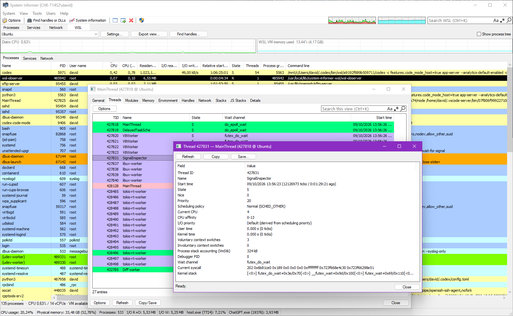

# WSL Tools for System Informer

Inspect and control WSL 2 from a native **WSL** tab in System Informer.

> [!WARNING]
> ⚠️ **When System Informer uses its driver module (KPH), this plugin requires “Allow untrusted plugins”.** KPH uses its own trust list; it does not trust this plugin yet, and ordinary code signing would not be enough.
>
> **This allows untrusted DLLs to load and reduces System Informer's kernel-driver access, disabling some Windows inspection and control features.** The installer explains the choice. WSL Tools does not need KPH; a separate `-nokph` instance is another option. [Details and restoring protection](docs/user-guide.md#restoring-image-load-protection).

## Features

- **Processes:** CPU and memory graphs, average CPU, process trees, filtering, and configurable columns.
- **Inspectors:** threads, modules and ELF symbols, memory, environment variables, and open file descriptors.
- **Stacks:** native GDB stacks plus JavaScript, Python, and Java stacks with the appropriate tools installed.
- **Network:** find listening ports and connections, resolve remote hostnames, and jump to the owning process.
- **Services:** inspect systemd units and journals; start, stop, restart, and change startup behavior.
- **Controls:** send signals, adjust niceness, CPU affinity and I/O priority, and save scheduling rules per executable.
- **Find handles:** search open files and mapped modules across a distro, then open the process or file location.

Uses System Informer's fonts, colors, search, refresh controls, and saved column layouts. Background capture fills histories from startup for already-running WSL2 distros. The companion runs as **Linux root**. Monitoring attaches to running distros and leaves `vmmemWSL` CPU accounting unchanged.

## Install

> [!TIP]
> **TL;DR:** Close System Informer, run `WslTools-*-setup-x64.exe` (using the current version number instead of `*` of course), and accept the offered loading options. **Allow untrusted plugins** is needed because KPH does not trust this plugin. Both loading options can optionally be reset during uninstallation.

1. Run the installer as your normal Windows user and select your System Informer folder. Windows may request elevation to copy files there.
2. Leave **Install companion in all WSL2 distributions** checked to install the Linux helper. Stopped distros are temporarily started and stopped again afterward.
3. Restart System Informer, open **WSL**, and select a running distro. If its companion is missing, use **Install and retry**. Installed companions update automatically when needed.

Requires **x64 Windows and x86-64 WSL2**; WSL1 is not supported. Systemd is needed only for service features. The plugin has been exercised with System Informer **4.0.26255.346**; it does not impose an exact-version restriction. [Compatibility details](docs/user-guide.md#compatibility).

**Portable/manual install:** use `WslTools-*-windows-x64.zip`. See the [manual installation instructions](docs/user-guide.md#install).

**Uninstall:** close System Informer and remove **WSL Tools** from Windows **Installed apps**. You can remove the companions and optionally reset either loading option; those reset checkboxes default off. [Manual companion removal and protection settings](docs/user-guide.md#restoring-image-load-protection).

## Getting started

Double-click a process or service for properties; right-click for actions. Use the regular toolbar search and **View → Refresh** controls. Configure WSL-specific preferences and Explorer path overrides under **Options → WSL**. Stack tools are optional; the plugin explains what to install when one is missing.

- [User guide](docs/user-guide.md): detailed features, shortcuts, settings, installation options, and limitations.
- [Changelog](CHANGELOG.md): what's new in each version.
- [Build instructions](docs/building.md): compile the plugin, companion, and installer.
- [Architecture](docs/architecture.md) and [wire protocol](docs/protocol.md): implementation reference.

## Licensing

Original project code: [MIT, David Trapp / Trapp Innovations](LICENSE). Dependencies retain their own licenses; see [third-party notices](THIRD_PARTY_NOTICES.md).
